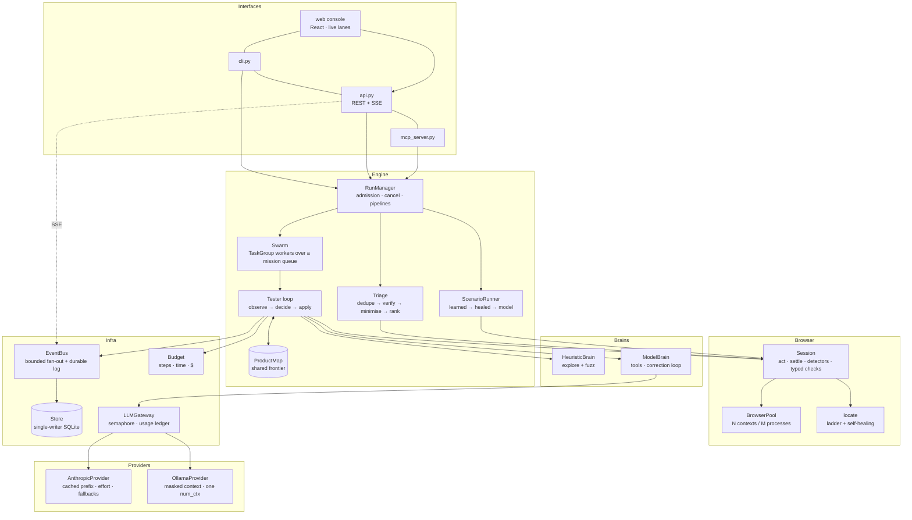

# Catchbunny

An autonomous QA swarm for web apps. Point it at a URL: parallel browser agents map the product, hunt for bugs, **prove every finding by replaying it in a fresh browser**, shrink it to a minimal reproduction, and hand it back as a regression test that needs no model to run.

On the bundled benchmark (a shop with 11 seeded bugs and several traps), with no model calls at all:

| | |
|---|---|
| Bugs that raise an error anywhere | **9 of 9 found** |
| Confirmed findings that are real | **10 of 10** (0 on the fixed build, traps included) |
| Reproduction length | 78 steps → 28 after minimisation |
| Exported regression scenarios | 10 of 10 fail on the buggy build, 10 of 10 pass on the fixed build, 0 model requests |
| Throughput | 9 → 50 steps/s from 1 → 8 testers (4.6× faster wall clock) |
| Evidence per finding | video, Playwright trace, network + console log, timeline with the moment the defect fired |

The two it does not find are purely semantic (a negative cart total, a stale counter): nothing errors, so only a tester that understands the page can see them. **With Claude Opus 5.5 driving the testers, one run confirmed both**, each replayed in fresh browsers, for 96 model requests and $0.75. See [Model providers](#model-providers). Full numbers: [bench/RESULTS.md](bench/RESULTS.md).

It tests in Chromium, Firefox or WebKit (the engine Safari is built on), reaches into the app's own iframes and shadow roots, uploads files and drags what can be dragged.

It is an [MCP server](#use-it-from-a-coding-agent-mcp): Claude Code, Codex, Claude and ChatGPT can run it themselves. It comes with a [web console](#web-console) - watch every tester work on a live timeline, open a finding, and scrub the recording of the replay that confirmed it - and it runs [on your own machine or for a team](#serve-it-for-a-team) on your own domain, with a sign-in.

## Quick start

Install it, start it, and the console opens in your browser. Nothing goes into your app: no SDK and no code. Catchbunny needs only its address. Tested on macOS; Linux should work the same way; Windows has not been tried.

**1. Install.** This installs [uv](https://docs.astral.sh/uv/) if you do not have it, then Catchbunny, then the browser it tests with ([what the script does](install.sh)). Running it again updates Catchbunny.

```bash
curl -LsSf https://raw.githubusercontent.com/cpldxx/catchbunny/main/install.sh | sh
```

**2. Start it,** in a new terminal so it finds the command the installer just added. The console opens at http://127.0.0.1:8700/app, and the MCP endpoint for coding agents is at `/mcp` on the same port.

```bash
catchbunny start
```

**3. Test an app.** In the console, choose **Add an app** and enter the address of an app that is running, such as `http://localhost:3000`. No app running yet? Choose **Scan the demo shop**: a small store with bugs planted in it starts beside Catchbunny, and six testers scan it while you watch.

**4. Connect your coding agent** (optional). This finds Claude Code and Codex on this machine and points both at the MCP endpoint:

```bash
catchbunny connect
```

That is all of it. Three commands:

| Command | What it does |
|---|---|
| `catchbunny start` | The console in your browser, the API and the MCP endpoint, on port 8700. `--team --public-url https://qa.example.com` serves it [for a team](#serve-it-for-a-team) |
| `catchbunny scan <url>` | Scan a running app from the terminal or CI, without the console. Exit code 0 passed, 1 a confirmed finding at or above the gate, 2 could not test |
| `catchbunny connect` | Point Claude Code and Codex at the MCP endpoint ([below](#use-it-from-a-coding-agent-mcp)) |

`catchbunny <command> --help` lists the options: `scan` takes `--user`/`--password` for a test account, `--browser webkit` for the engine Safari is built on, `--devices desktop,iphone`, and `--brain claude` (with `ANTHROPIC_API_KEY`) or `--brain ollama --model <tag>` for model-driven testers. Runs, findings and recordings are kept in `~/.catchbunny`, whoever starts them, so the console shows a scan from the terminal or an agent too.

Already have uv? `uv tool install git+https://github.com/cpldxx/catchbunny` does the same as the script; the browser is then downloaded on first use.

### From a checkout

To work on Catchbunny itself:

```bash
git clone https://github.com/cpldxx/catchbunny && cd catchbunny && uv sync
```

```bash
uv run pytest
```

`uv run catchbunny ...` runs the checkout. The site is committed built in `web/dist`, so a `git+https` install needs no Node; after changing anything under `web/src`, rebuild it with `(cd web && npm install && npm run build)` and commit `web/dist` with the change. `uv run python bench/run_bench.py` regenerates `bench/RESULTS.md` and the landing page's benchmark; `uv run python bench/run_model.py --brain claude` measures a Claude-driven run (spends up to $2).

With `ANTHROPIC_API_KEY` set, `--brain auto` adds Claude-driven testers on top of the heuristic ones. `--brain ollama --model <tag>` does the same with a model on your own machine: no key, nothing billed, nothing leaves it. Without either, everything above still runs.

## Architecture



| Layer | Module | Responsibility |
|---|---|---|
| Domain | `domain.py` | Vocabulary shared by every layer: `Action`, `ElementSig`, `Check`, `Signal`, `Finding`, `Scenario`, `Run`. No I/O. |
| Browser | `browser/observe.py` | One `evaluate` call turns the DOM into an `Observation`: controls with durable signatures, page-level defects, state identities. |
| | `browser/locate.py` | Finds a recorded element in a different page load: exact locators first, similarity-based healing last, refusal when ambiguous. |
| | `browser/session.py` | Browser pool; per-tester session with always-on detectors, adaptive settling, typed checks, policy guard. |
| Brains | `brain/base.py` | The `Brain` port: `decide(observation, feedback) → intents`. |
| | `brain/heuristic.py` | No model: systematic exploration and form fuzzing (valid / empty / hostile / boundary input). |
| | `brain/llm.py` | Everything about a model-driven tester that is not specific to one model API: the tool vocabulary, the prompts, the tester loop, planner, outcome judge, the gateway, and the `Provider` port. |
| | `brain/claude.py` | Anthropic provider: frozen cached prefix, effort, refusal fallbacks, pricing. |
| | `brain/ollama.py` | Ollama provider: native `/api/chat`, a masked view of the transcript, one context size for every request. |
| Engine | `engine/productmap.py` | The swarm's blackboard: screens, transitions, and `claim()` - the one coordination primitive. |
| | `engine/tester.py` | One mission in one browser: the loop every brain runs through. |
| | `engine/replay.py` | Deterministic replay and parallel delta debugging. |
| | `engine/triage.py` | Signals → findings: dedupe, fresh-browser verification, localise, minimise, rank. |
| | `engine/scenarios.py` | Scenario files, learned-step replay, and exports (scenario YAML, Playwright test, fix prompt). |
| | `engine/orchestrator.py` | `App` (composition root) and `RunManager` (discovery, deep scan, scenario pipelines). |
| Infra | `store.py`, `events.py`, `budget.py`, `vault.py` | Persistence, event stream, shared budget, encryption of stored passwords. |
| Interfaces | `api.py`, `cli.py`, `mcp_server.py` | Thin: validate, delegate, serialise. REST + SSE for a UI, a CLI for CI, MCP tools for coding agents. |

### What a run does

1. **Prepare** - load the project's map from earlier runs; sign in once per persona (single-flight) and copy that session into every tester.
2. **Plan** - explorers for every persona × device, fuzzers for every persona; with a model, a mapping phase feeds a planner that writes goal-directed charters.
3. **Swarm** - `testers` workers pull missions from a queue. Each runs `observe → decide → apply`; `ProductMap.claim()` gives every unexplored control to exactly one tester.
4. **Triage** - one candidate per defect signature, represented by its least-privileged witness; replay it in fresh contexts (`confirmed` / `flaky` / `not reproduced`); try the actions since the last page load first, then delta-debug down to a minimal reproduction; replay that once more on camera.
5. **Report** - findings ranked by evidence-based severity. A confirmed finding at or above the gate (`P1` by default) fails the run and the process exit code. A run that could not test what it was asked to (app down, a persona that cannot sign in) is `blocked`, never `passed`.

### Concurrency model

Everything a tester waits on is I/O (CDP round trips, model calls), so the whole swarm is one asyncio event loop. Threads appear only where the work is blocking: SQLite and file writes go through `asyncio.to_thread`.

| Mechanism | Where | Why |
|---|---|---|
| Contexts, not browsers | `BrowserPool` | A context is isolated (cookies, storage) and costs milliseconds; a browser process per tester would not. Contexts per process are capped, total contexts are bounded by a semaphore. |
| Lock-free shared state | `ProductMap.claim`, `Budget.take_step` | Synchronous methods cannot interleave on one loop, so check-and-reserve is atomic without locks: two testers never take the same control or the last step. |
| Structured concurrency | `RunManager._swarm` | Workers live in a `TaskGroup`; a mission catches its own failure, cancellation propagates through the group and releases every context. |
| Single-flight sign-in | `_signed_in_state` | N explorers of one persona trigger one login and share its session. |
| Account lock + fresh sign-in | `RunManager.session(exclusive=True)` | Work whose verdict depends on state (verification, minimisation, scenarios) gets its own sign-in and holds the persona's account, so replays neither inherit leftovers from the hunt nor rearrange one account under each other. Anonymous personas stay fully parallel. |
| Settling by asking the page | `Session.settle` | No fixed sleeps. A step ends when the page itself reports nothing in flight (fetch/XHR counted at the call site, pending navigation, images) and no DOM mutation for 40 ms, *and* the browser reports no request in flight. |
| Single-writer store | `Store` | All writes go through one queue and are group-committed in one thread hop; hot-path writes never block a tester; WAL keeps reads concurrent. |
| Bounded fan-out | `EventBus` | `publish` is synchronous; each subscriber has a bounded queue that drops its oldest event, so a stalled SSE client cannot slow the swarm. History + live resume has no gap and no duplicate. |
| Parallel delta debugging | `replay.ddmin` | All chunks and complements of a round are replayed concurrently, each in its own context. |

### Design decisions

- **Evidence over opinion.** Verdicts rest on typed checks and detector signals. A model's bug report is rejected unless it supplies a check that fails on the live page, and it is confirmed only if that check fails again on replay.
- **Verify before reporting.** Nothing is shown as a bug because it was seen once. Fresh-browser replay is what keeps precision at 100% on the benchmark.
- **Absence is a claim, not a proof.** A check that fails because the wrong thing *is* on the page (`text_absent`, a field holding the wrong value) is an observation a replay can repeat. A check that fails because something is *missing* looks the same whether the app is broken or the expectation was wrong - and deleting steps can only keep it missing, so minimisation would shrink such a "proof" to a bare page load. Those reports are kept but labelled unverified, and a check on a control that does not exist is rejected outright. For the same reason a model's report is never minimised: its check is evidence, not a complete oracle. These rules exist because local models produced exactly these failures: see [Model providers](#model-providers).
- **Ports for the expensive parts.** The engine does not know whether a model, rules or a test script is driving. The model side has a second port, `Provider`, so the tester loop does not know which model API it is talking to either. That is what makes the system testable end to end with no network, and runnable with no API key.
- **Conservative healing.** A moved control is re-found by similarity only when the best match is good *and* clearly better than the runner-up. A wrong click is worse than a failed step.
- **A reproduction must stand on its own.** It starts from a named page, is replayed from a clean sign-in, and prefers the least-privileged persona that can hit the bug - so it never depends on a cart someone else filled or on where a session happened to be standing.
- **Verdicts must not depend on timing.** "This button does nothing" is decided from the page's own counters (DOM hash, calls it started, side effects), not from which network events happened to arrive in a time window.
- **A persona on a device is its own app.** Exploration progress is scoped per persona × device, and site chrome (nav, header, footer) is explored once per scope rather than once per screen.
- **Supervisor-enforced policy and secrets.** `read_only` / `safe_writes` / `full` is checked before every action, for every brain. Passwords are injected at execution time and never enter a trace, an event or a prompt.

### What profiling changed

One tester spent 73% of every step waiting for the page to "settle" (160 ms of a 220 ms step), because settling meant "no network activity for 120 ms". Replacing that with the page-side quiescence check above cut it to 65 ms: **5.0 → 9.1 steps/s per tester, 34 → 53 steps/s at 8 testers**, with the same findings.

The shorter window also exposed three latent nondeterminisms, each now covered by a regression test:

1. The dead-click verdict counted browser network events, so a late favicon request could flip it → it now reads the page's own call counter.
2. Self-healing matched on role, tag and position, and once healed "Apply coupon" onto "Copy link" on an empty cart → a named control is never healed onto a differently named one.
3. Testers of one signed-in persona shared a server session, so minimisation could "shrink" a reproduction into relying on items another tester had left in the cart → account lock, fresh sign-in, and least-privileged witness.

## Evidence

Every confirmed finding is replayed one final time with recording on (`RunSpec.record`, default true):

| | |
|---|---|
| `video` | WebM of the reproduction |
| `trace` | Playwright trace archive (DOM snapshots per action; open with `playwright show-trace`) |
| `timeline` | each action with its start time and duration |
| `network`, `console` | every request (method, URL, status, type) and console message, on the same clock |
| `fired_at_ms` | when the defect showed itself, for "jump to the moment" playback |

## Use it from a coding agent (MCP)

Catchbunny is an MCP server, so an agent that has just changed your code can test the result itself: scan the dev server, read a finding precise enough to act on, fix it, and ask whether it is gone.

### The endpoint

`catchbunny start` serves MCP over Streamable HTTP at `http://127.0.0.1:8700/mcp`, on the same port as the console. Any MCP client can use it. On your own machine it needs no key, because the server answers only requests addressed to localhost. Because the agent talks to the same server as the console, a scan it starts shows in the console as it happens.

### Claude Code and Codex

```bash
catchbunny connect
```

It finds Claude Code and Codex on this machine and points each at the endpoint; name one to connect only that (`catchbunny connect codex`). Or use the agent's own command:

```bash
claude mcp add --transport http catchbunny http://127.0.0.1:8700/mcp
```

```bash
codex mcp add catchbunny --url http://127.0.0.1:8700/mcp
```

Then start your app and ask the agent: *"scan http://localhost:3000 with Catchbunny and fix what it finds."* The console's **Connect an agent** page shows the same commands with the server's own address filled in, and on a team server makes the key.

| Agent | Name | Where it goes |
|---|---|---|
| Claude Code | `claude-code` | Added for every project through Claude Code's own `claude mcp add-json --scope user`. Without the `claude` command on `PATH`, `.mcp.json` in the current project |
| Codex (CLI, IDE extension, desktop app) | `codex` | One `[mcp_servers.catchbunny]` table in `~/.codex/config.toml` |
| Claude Desktop | `claude-desktop` | One entry under `mcpServers` in `claude_desktop_config.json`, which starts Catchbunny itself (that file takes commands, not addresses). Named only, never found automatically; quit Claude first: it rewrites that file while it runs, and `connect` refuses rather than race it |

`connect` touches one entry named `catchbunny` and nothing else in the file: other servers, comments and ordering stay as they were, the previous file is kept as `.bak`, a file that does not parse is left alone, `--print` shows the entry without writing, and `--remove` takes it out.

With `--stdio`, the agent starts a Catchbunny of its own over stdio instead, so nothing needs to be running. The command it writes is an absolute path, because an app started from the dock does not have your shell's `PATH`. That server keeps its records in `~/.catchbunny` too, so the console lists its runs. Several servers can share that directory: each run records the process that owns it, so a server starting up does not mistake another server's run for one that died.

### Claude and ChatGPT

Their connectors reach a server over the internet, from the vendor's servers, so they need an address with HTTPS. [Serve Catchbunny for a team](#serve-it-for-a-team) and add `https://<your address>/mcp` as a custom connector (Claude: Customize > Connectors > Add > Add custom connector). The connector finds the server's OAuth metadata, registers itself, and sends you to your own server to sign in and allow it. No token is pasted anywhere.

Scans are made **from the machine Catchbunny is on**: `http://localhost:3000` in a scan is that machine's own dev server. Whoever can use the endpoint can make that machine open any address it can reach, so nothing but localhost is answered without a sign-in or a key, and `--host 0.0.0.0` without `--team` is refused.

### Tools

| Tool | |
|---|---|
| `scan` | Hunt for bugs at a URL (optionally only under some paths); returns verified findings, one line each, or `running` and a run id |
| `run_status` | Wait for a run and return its result |
| `list_findings`, `get_finding` | Detail for one finding: expected/actual, minimal steps, failed requests, console errors, and a ready-made task description |
| `verify_fix` | Replay the reproduction against the app as it is now |
| `keep_as_scenario` | The regression test as YAML to commit |
| `run_scenarios` | Run committed scenario files; learned steps need no model |

Results are kept small on purpose (ids and one-line summaries; detail on request), and anticipated failures come back as readable tool errors. Tools that drive a browser are annotated as acting, the rest as read-only, so a client can ask before the first kind and not the second.

**No tool holds a call open for the length of a run.** A scan takes minutes; Codex cuts a tool call off after 60 seconds by default, and a proxy in front of a remote server after about 100. So `scan` waits a bounded time (45 seconds, capped at 50 over HTTP whatever the caller asks for) and, if the run is still going, returns `running` with a run id and how far it has got; `run_status` waits for the rest in calls of the same length. The run itself is not tied to the call that started it.

### What was checked, and what was not

- A real MCP client drove the whole loop over stdio (starting the server with the exact command `connect` writes), over HTTP with a token, over the `/mcp` endpoint of `catchbunny start`, and with a personal key against a team server. The token gate, the polling path and the installer are covered by `tests/test_connect.py`; the team server by `tests/test_team.py`.
- **The OAuth sign-in was driven by the MCP SDK's own OAuth client**: metadata discovery, dynamic registration, the consent page's API, the PKCE code exchange, an authenticated tool call, and a refresh that retires the pair it replaces. Declining is covered too.
- **Codex itself ran a session against it.** The Codex binary that ships in the ChatGPT desktop app (0.148), pointed at `/mcp` with a one-off `-c mcp_servers.catchbunny.url=...`, called `scan` on the demo shop's product pages, then `get_finding`, and reported the four confirmed findings and the three-step reproduction. In `codex exec`, a tool that acts is cancelled unless approvals are routed somewhere: `--approve-for-me` does that.
- **Claude Code itself ran a session against it.** Claude Code 2.1.321, given only the endpoint (`{"type": "http", "url": ".../mcp"}`) and allowed the Catchbunny tools, called `scan` on the demo shop's product pages, `run_status`, `get_finding` and `verify_fix`, and reported the four confirmed findings, the three-step reproduction and "still broken". The server's own log shows the eight MCP requests, and its database the run with exactly the parameters asked for. It ran headless (`claude -p --bare`) with an API key, on Claude Haiku 5.5.
- **Not exercised:** the connectors inside Claude and ChatGPT, which need a server on a public address. Their side is written from their documentation as of November 2026. There is no Claude Code plugin yet: packaging one needs a published repository to install from.

## Serve it for a team

```bash
catchbunny start --team --host 0.0.0.0 --public-url https://qa.example.com
```

The same server, shared. `--public-url` is the address people and agents will type; put a reverse proxy with a certificate in front (with Caddy: `qa.example.com { reverse_proxy 127.0.0.1:8700 }`).

- **Getting in.** The first start prints a link with a setup code; whoever opens it becomes the owner. The owner sees the **team code**; a colleague creates their own account with it at `/app/join`. The owner can replace the code (the old one stops working, people stay) and remove a person (their sign-ins, keys and connectors stop at once).
- **Keys.** A person makes a key per place they use it (an agent, a CI job) on the Connect an agent page. It is shown once. It works as `Authorization: Bearer cb_...` on `/v1` and on `/mcp`.
- **Connectors.** A client that cannot hold a key signs the person in with OAuth 2.1 (authorization code + PKCE, dynamic client registration), using the MCP SDK's authorization-server routes with Catchbunny as the provider (`oauth.py`). This needs HTTPS; on plain HTTP other than on the machine itself, the server offers keys only.
- **What is kept.** Passwords are stretched with scrypt. Sessions, keys, the setup code's use and connector tokens are stored as hashes. The cookie is HttpOnly and SameSite (Secure on HTTPS); a state-changing request from another origin is refused even with it; eight wrong passwords for one address in five minutes make that address wait.
- **On your own machine nothing changes**: no accounts. But `catchbunny start` answers only requests whose `Host` is localhost and sends no cross-origin headers, so a web page you happen to have open cannot drive it; and it refuses to listen on the network unless it is serving a team.

One team per server, shared apps and runs, email and password only (no single sign-on, no password reset by email).

## Model providers

A model-driven tester is the same loop whichever model answers. `brain/llm.py` owns the tool vocabulary, the prompts and the transcript; a `Provider` turns one turn of it into one request. What differs between providers is the cost model, and therefore the context strategy:

| | Claude (`brain/claude.py`) | Ollama (`brain/ollama.py`) |
|---|---|---|
| What is scarce | Money per token | The context window |
| The transcript is sent | Verbatim, append-only: an unchanged prefix is a cache hit, and thinking blocks must come back untouched | As a view in which only the newest page outline is whole; older ones are cut to URL and title |
| Shared prefix | Frozen tools + system prompt behind a cache breakpoint; one `max_tokens=0` request writes it before the swarm fans out | The runner's KV cache; a masked outline is a prefix of the whole one, so each turn re-evaluates one page, not the conversation |
| Warm-up | Writes the cache entry | Loads the model and evaluates the prefix once |
| Structured output (planner, judge) | `output_config.format` | `format` with the same JSON schema |
| Tool calls | `strict: true` | Not enforced by the runner, so the tester loop corrects malformed or missing calls in the transcript and asks again |
| Things that must not vary | Tools, system prompt, effort | `num_ctx`: a different value reloads the model (31 s for an 8B model here) |
| Cost accounting | Priced per request, capped by `max_usd` | `$0`; cached tokens are the reused KV-cache prefix |

Claude defaults: `claude-opus-5-5` (`CATCHBUNNY_MODEL`), effort `low` for tester turns and `medium` for planning, server-side refusal fallbacks on (`CATCHBUNNY_LLM_FALLBACKS=0` disables). Ollama: `--model` or `CATCHBUNNY_OLLAMA_MODEL`, `CATCHBUNNY_OLLAMA_NUM_CTX` (16384), `CATCHBUNNY_OLLAMA_THINK` (off), `OLLAMA_HOST` honoured. A missing server, a model that is not installed, or one that cannot call tools blocks the run before a browser opens, with the fix in the message. `GET /v1/models` lists what the server can run right now.

### What Claude found

`bench/run_model.py --brain claude` runs one deep scan of the benchmark shop with Claude driving the goal-directed testers (6 testers, 600 steps, a $2 cap) and records the result in `web/src/landing/models.json`, which the landing page reads.

| | Claude Opus 5.5, one run |
|---|---|
| Semantic bugs confirmed by replay | **2 of 2** (negative quantity accepted, cart counter does not drop) |
| Bugs that raise an error, in the same run | 8 of 9 |
| Reports kept out as not verified | 2 (a preferences page stuck on "Loading", and a checkout page that lists no items: neither could be shown by replay) |
| Steps | 354 |
| Model requests | 96 |
| Cost | $0.75 |

One run is one sample. The no-model benchmark is repeatable to the bug; a model's run is not, and this one has not been repeated yet.

Ollama's Anthropic-compatible endpoint would have been less code. Its documented request has no context size, keep-alive or JSON schema, and its usage has no cache counter, so the provider speaks the native API instead.

### What a small local model taught the engine

Live runs on an M1 Max (64 GB) against the benchmark shop, 2 testers, goal "check that cart quantities, prices and totals are always sensible":

| Run | Model | Requests | Prompt tokens reused from the KV cache | What the model's testers reported |
|---|---|---|---|---|
| 1 | `ministral-3:8b` | 61 | 58% | 3 findings marked confirmed - all three false |
| 2 | `ministral-3:8b`, after rules 1-2 | 37 | 59% | Nothing false, and nothing semantic found |
| 3 | `qwen3.6:35b` | 91 | 67% | The seeded stale-counter bug, found and replayed; one false confirmation; a reproduction shortened until it no longer showed the bug |
| 4 | `qwen3.6:35b`, after rules 1-3 | 70 | 63% | The stale-counter bug again, now with a reproduction that shows it (add, remove, add: the header says 2, the cart holds 1); two confirmations of a check with an empty operand |

Every run cost $0, and the detectors' findings were correct in all of them. What went wrong was always the same thing: the engine trusted a model's check more than it had earned.

- **Run 1.** The 8B model wrote checks that could never pass: `value_equals` on a control that did not exist, `text_visible` on a string no page would show. Each failed on the live page, failed again on replay, and was minimised to a bare page load. Three P1 findings, all confirmed, all wrong.
- **Runs 3 and 4.** The 35B model noticed that the header still said "Cart (2)" after the cart had been emptied - one of the two seeded bugs no detector can see - and proved it with `text_absent("Cart (2)")`. Minimisation then deleted the steps that emptied the cart, because the check kept failing without them: a cart with two items in it also shows "Cart (2)". The finding was true and its reproduction was not. The same run confirmed a `value_equals` that named no control, which had matched the first control on the page; the next confirmed `text_absent("")`, which "fails" on every page ever rendered.

Four rules came out of this, each with a test:

1. A check must say what it is about and be about something on the page. One with an empty operand, or naming a control that is not there, is rejected with the reason, so the model can try again in the same mission.
2. A check that fails only because something is missing is kept as an unverified claim. It is never replayed into "confirmed".
3. A model's report is replayed along the tester's whole path and is not minimised. Its check is evidence that the page is wrong at the end of *that* path; it is not a full specification of the defect to shorten against.
4. Detector findings are untouched: a detector's signature is a complete oracle, so any path that fires it is the same defect.

Run 4's empty-operand rejection was added after it and is covered by a test, not by a fifth live run.

What the rules cannot do is judge meaning. For a model's report, "confirmed" means the page showed the same thing again in fresh browsers; that it is a defect is still the model's judgement (run 4 also reported, truthfully, that the cart has no quantity editor - and called it P1). The console says so on every such finding.

In practice: an 8B model adds a plan and coverage, and did not prove a semantic bug here. A 35B model did, in both of its runs, at about one model turn every seven seconds across two testers. Claude-class models were the design target and are still the better tester; the local path is for when nothing may leave the machine or nothing may be spent.

## Web console

`web/` is a React + TypeScript single-page app, built with Vite and served by `catchbunny start` itself (one port, no CORS): the landing page at `/`, the documentation at `/docs`, the console at `/app`. Each is its own chunk: the landing page loads about 120 kB of script (gzipped) and the docs about 100 kB, and neither loads the console's component library; before the split every page loaded 400 kB. In development, `npm run dev` proxies the API, including the event stream.

- **Lanes.** One lane per tester, time running left to right. A block is one step, as wide as it took; a diamond above a block is a sighting, a step where a detector fired; the last lane shows each finding as a disc at the moment its fresh-browser replays finished, ticked if it replayed. Gaps are time spent waiting - on the page, or on a model. It is drawn on a canvas from the same SSE stream the API exposes, so a run in progress and a finished one are the same code path.
- **Findings.** Severity as signal-strength bars (red only at or above the run's gate), one pip per replay, expected against actual, the steps, and the recording with a reel under it: steps, requests and console lines on one clock, a marker where the defect fired, click to seek.
- **Actions.** Rerun in a fresh browser, keep as a scenario, copy the fix prompt, export a Playwright test, download the trace.
- **Scenarios and map.** Scenarios list how many of their steps replay without a model. The map is a table of routes, indented by address: screens that share a route (`/products/:id`, or two states of one cart) are one row with their coverage, and choosing a route marks what it leads to and what leads to it. An earlier version drew every screen as a box with lines between them; with site navigation on every page the lines said nothing and hid the structure.
- **Start a run.** Kind, goal, scope, devices, the browser engine, budgets, and who drives the testers - no model, Claude, or any tool-capable model Ollama has installed.
- **Connect an agent.** The MCP endpoint of this server and, for MCP in general, Claude Code, Codex, Claude and ChatGPT, what to run or enter with this server's address in it. On a team server it also makes and revokes your keys.
- **Team** (a team server only). The people, the team code and a new one on request. The ways in (set up, join, sign in, allow a connector) are pages of their own.
- **Keyboard.** `n` starts a run, `g` then `a` / `c` / `r` / `s` / `m` jumps between apps, connecting an agent, runs, scenarios and the map, `j` and `k` walk the findings, `?` lists them all. Rows that can be clicked hold a real link or button, and the chosen finding and the chosen route are in the address.

The site asks the server what it is (`/v1/meta`) before it offers a console. Served by `catchbunny start`, the pages say "Open the console" (or "Sign in" on a team server). A copy of the site on a static host has no server behind it, so there the console is not offered at all and `/app` explains how to get one.

### Landing page

The page at `/` explains the product by showing it. It follows the skeleton the products in this space use on theirs - what it does, then one figure per stage - and every figure is driven by one real deep scan of the bundled shop (333 steps, 9 findings), exported with host names removed.

- **The hero is that run, playable.** Six browser tiles show the page each tester is on and what it just did; a tile lights up when a detector fires; findings arrive in the list as their replays finish. A transport plays, pauses and scrubs through the run. The event log goes through the console's own reducer (`liveFrom` in `stream.ts`), so the page and the console cannot drift apart.
- **One figure per stage**, each with a title and a sentence:
  1. *Map* - the same route table as the console, filling in the order the screens were found, beside one real screenshot at a time; pointing at a route shows its screen and marks where it leads.
  2. *Hunt* - the console's own lane chart on the same clock as the hero, with how often each detector fired.
  3. *Verify* - the nine candidates being replayed in fresh browsers, in the order the run confirmed them.
  4. *Shorten* - the 18 steps a tester actually took, and the 10 the bug needs, switchable.
  5. *Inspect* - the recording of the replay that confirmed a finding, with a reel and a step list that follow it; clicking either seeks the video.
  6. *Hand off* - the figure leads with what it is, an MCP server, and how to connect one (MCP first, then Claude Code, Codex, Claude, ChatGPT, each with its one command); below it, four of the tools and what each returned for this run.
- **Each stage carries its own number** from that run (16 screens, 333 steps, 9 findings, 18 steps cut to 10), under its sentence.
- **Then the benchmark, as what it is with no model**: nine planted bugs that raise an error, nine caught, in large numbers (9 of 9, 0 findings on the fixed build, 10 of 10 regression tests, 4.6 times faster with eight testers) sitting on the table that proves it, row by row with what was reported and how far the reproduction shrank. It is read from `web/src/landing/bench.json`, which `bench/run_bench.py` writes and which still holds all eleven. The two planted bugs where nothing errors are a model-driven tester's work; they are counted in the next section (what a model adds, from `models.json`, which `bench/run_model.py` writes) and in the docs, not in the headline.
- **Then two ways to run it** (alone, or for a team on your own domain), and what the testers reach, as a ticked list. What it does not do is linked from there and lives in the docs.
- **Documentation at `/docs`**: quick start, how a run works, scenarios, coding agents, teams, models, a reference and the limits, written from this file.
- **Nothing is invented.** No customer logos, testimonials, pricing or usage counts, because there are none.

Motion is there to explain: screens appear as they were discovered, pips fill as replays finish, steps are struck as they are removed. Each figure plays once when it is first seen, the run pauses when it is off screen, and everything stands still for a visitor who prefers reduced motion. The assets are in `web/public/demo/` (page screenshots and the replay video) and `web/src/landing/demo-run.json`; `web/scripts/export_demo.py --run <id>` regenerates all of them from any finished run of the demo shop.

The demo shop itself (**Scan the demo shop** in the console, `src/catchbunny/demo_shop.py`) is dressed as a real small store - illustrated products, a proper cart and checkout - because it is what people see in the tiles and the recording. The dressing is presentation only: every control, label, id and handler is unchanged, nothing loads from another origin, and no decoration is interactive. One thing did leak while restyling it: a placeholder on the newsletter field gave the field an accessible name and silently repaired a seeded bug. The test suite caught it, and the placeholder is gone.

### Design

[DESIGN.md](DESIGN.md) is the design system and [PRODUCT.md](PRODUCT.md) is what the product is; `web/src/theme.ts` holds the values the code reads. In short:

| | |
|---|---|
| Character | Playful name, exact tool: friendly in what it says, strict in what it claims |
| World | A meadow after dark. Grounds are a green so deep it reads as night, text is moonlit, and the one bright colour is the moon's pale yellow |
| Logo and marks | The bunny is the logo and nothing else. Inside the product a diamond is a sighting (a detector fired) and a ticked disc is a catch (a defect that replayed) |
| Emphasis | On the landing page, numbers the product measured are loud: the display face at 64 to 120px, counted up when first seen, with two pen strokes under the one a section turns on |
| Type | Recursive Casual for the name and headlines, Atkinson Hyperlegible Next for everything that is read, Recursive Mono for code |
| Surfaces | The landing page persuades, the console is a tool, the docs are a document; each is designed for that and loads only its own code |

It was built by reading six public guides and applying what each asks for: Anthropic's `frontend-design` skill, ui-ux-pro-max, awesome-design-md (the shape of DESIGN.md), impeccable, open-design's craft rules, and Vercel's Web Interface Guidelines and React rules. DESIGN.md lists what was taken from each, and what was not: no tool from those repositories was installed or run, Title Case was not adopted, and long tables are not virtualised. The first design pass used the [unslop](https://github.com/heydamir/unslop) method by Damir Sokolovsky ([@heydamir](https://x.com/heydamir)), CC BY 4.0; its 4px grid and quiet chrome remain.

What the audit against those guides changed, beyond the look: rows that only a mouse could open now hold a link or a button; every list has an error state with a way to retry; images and the demo recording declare their size; numbers, money and dates go through `Intl`; the selection, the scrollbar, the caret and the focus ring are themed; a skip link and keyboard shortcuts were added; and the bundle was split by surface.

The stack follows GitHub stars, read from the API on 2026-11-11, with one deliberate skip:

| Role | Choice | Stars |
|---|---|---|
| UI library | React | 252,527 |
| Language | TypeScript | 111,780 |
| Components | Ant Design 6 | 100,163 |
| Build | Vite | 83,872 |
| Routing | React Router | 56,636 |
| Server state | TanStack Query | 50,571 |

Bootstrap (175,036) is a CSS toolkit rather than a React component library, and has no table, drawer or form model to build a dense tool on. shadcn/ui (127,934) is the highest-starred React option - and the default output of every app generator, which is the look this console set out not to have. Ant Design is next, and is built for exactly this kind of data-heavy tool. It is themed through tokens (`web/src/theme.ts`) rather than used as shipped, and its outlined icon set is the only one in the app.

## How it relates to existing products

The feature set was reconstructed from the public documentation and marketing pages of four products in this space (Composal, Simulithic, Canary, Aucert). No account was created and no private interface was inspected.

| Observed in the reference products | Here |
|---|---|
| Discovery maps screens and flows and suggests tests | `discovery` run: shared product map, scenario drafts written from observed journeys and kept only if they replay |
| Parallel testers pressure-test flows toward a goal | `deep_scan` run: explorers + fuzzers, plus model charters (Claude or a local model) planned from the map |
| Findings carry expected / actual / steps / recording / logs, with "rerun in a fresh browser" as a button | Every finding is re-run automatically before it is reported, then recorded (video, trace, network, console); `POST /findings/{id}/rerun` on demand |
| "Keep it as a scenario", "send to your coding agent" (CLI + MCP) | `export --format scenario \| playwright \| prompt`, and an MCP server (stdio and HTTP) with `scan` / `get_finding` / `verify_fix` / `run_scenarios`, registered with `catchbunny connect` |
| Shared-account locks | Per-persona account lock around every state-asserting session |
| Scenarios in plain English with expected outcomes | Same, plus typed checks that the engine evaluates itself |
| Learned steps: replay a passing run's actions, heal moved controls, fall back to the model | `ScenarioRunner` ladder: learned → healed → model, 14-day TTL, checks re-evaluated on the live page |
| Allowed actions, test accounts the model cannot read | Policy guard and supervisor-injected credentials |
| Pick the scenarios a pull request affects | `POST /projects/{id}/relevance` (lexical baseline) |
| Device matrix | Device profiles per mission; exploration scoped per device |
| Release gate | Run status + exit code from confirmed findings at or above `gate` |

Where this goes further: verification is automatic rather than a button; reproductions are minimised by delta debugging; a regression scenario exported from a finding runs with zero model calls; and the whole pipeline has a reproducible seeded-bug benchmark with a false-positive check.

## HTTP API

`catchbunny start` → `http://127.0.0.1:8700` (interactive API reference at `/v1/docs`; `/docs` is the product's own documentation).

| Method | Path | |
|---|---|---|
| GET | `/`, `/docs/...`, `/app/...` | The landing page, the documentation and the web console, when `web/dist` has been built |
| GET | `/v1/meta` | What this server is: local or team, its address, its MCP endpoint, who is signed in |
| POST | `/mcp` | The MCP endpoint (Streamable HTTP) |
| POST | `/v1/auth/setup`, `/v1/auth/join`, `/v1/auth/sign-in`, `/v1/auth/sign-out` | A team server's ways in |
| GET / PATCH / POST / DELETE | `/v1/team`, `/v1/team/code`, `/v1/team/members/{id}` | People, the team code, removing someone (owner) |
| GET / POST / DELETE | `/v1/tokens`, `/v1/tokens/{id}` | Your keys |
| GET | `/v1/models` | Which brains can run right now (Claude key present, Ollama models installed), and why not |
| POST / GET | `/v1/projects` | Create / list projects (credentials are write-only) |
| GET / PATCH | `/v1/projects/{id}` | Read / update base URL, personas, policy, product notes, the reset path |
| GET | `/v1/projects/{id}/map` | Screens, transitions, per-screen coverage |
| POST / GET | `/v1/projects/{id}/scenarios` | Upload scenario YAML / list |
| POST | `/v1/projects/{id}/relevance` | Rank scenarios against changed files and a diff |
| POST / GET | `/v1/projects/{id}/runs` | Start a run (`Idempotency-Key` supported) / list |
| GET | `/v1/runs/{id}` | Status, phase, summary |
| GET | `/v1/runs/{id}/events` | Server-Sent Events; resumes from `Last-Event-ID`; every event carries its `ts` |
| POST | `/v1/runs/{id}/cancel` | Cancel |
| GET | `/v1/runs/{id}/missions`, `/v1/missions/{id}/steps` | What each tester did |
| GET | `/v1/runs/{id}/findings`, `/v1/findings/{id}` | Ranked findings, with reproduction steps |
| GET | `/v1/findings/{id}/export?format=` | `scenario`, `playwright`, `prompt` |
| POST | `/v1/findings/{id}/scenario`, `/v1/findings/{id}/rerun` | Keep as a scenario / re-verify now |
| GET | `/v1/artifacts/{name}` | Screenshots, videos (`video/webm`), traces |

Event types: `run.queued`, `run.phase`, `login`, `mission.started`, `step`, `mission.finished`, `finding`, `scenario.started`, `scenario.step`, `scenario.finished`, `scenario.drafted`, `run.warning`, `run.finished`. Errors use one envelope: `{"status": "error", "code", "message", "retryable"}`. On a team server every `/v1` path but `/v1/meta` and `/v1/auth/*` answers `401 UNAUTHENTICATED` without a signed-in browser or a key.

## Limits

- The Claude path has been run live once against the benchmark shop (both semantic bugs confirmed, $0.75; see [What Claude found](#what-claude-found)). One run is one sample: its recall and cost will vary from run to run, and it has not been repeated. The test suite covers the same path with a scripted stand-in for the model. The Ollama path has been run live too; its numbers are modest.
- A model's report cannot yet say what makes an observation wrong ("this count is shown *while* the cart is empty"), so its reproduction is the tester's unshortened path. Two reports with the same check on the same kind of page are now one finding.
- **Browsers.** Chromium and WebKit are exercised by the tests. WebKit is the engine Safari is built on, as Playwright ships it, not the Safari application. Firefox goes through the same code, but Playwright's Firefox build does not start on the development machine (macOS 27), so that path has only been run as far as the tests that skip when an engine is missing. Firefox has no mobile mode.
- **Pages.** The app's own iframes are searched (at most six per page); iframes from another origin are left alone on purpose. A closed shadow root is opened so its controls can be found; one declared in markup (`shadowrootmode="closed"`) is not. Drag and drop is tried where an element is marked `draggable`; libraries that build dragging from pointer events alone are not recognised. Uploads use small generated samples, an empty file, a hostile name and an eight-megabyte file.
- Account-level state survives a fresh sign-in. With `--reset-path` the app's own reset is called before every replay (and those replays run one at a time); without one, a reproduction can come to lean on leftovers.
- Screens that depend on session state another tester built cannot be reached by URL; the tester that built them explores them, others skip them.
- "Does nothing" detection cannot see every effect (it does see DOM changes, requests, navigation, dialogs, clipboard, storage, history, print). It is P3, or P2 when the control's label says it is one a person came to use (pay, save, apply, sign in).
- Scenario relevance is lexical. Multi-actor scenarios and scheduled monitors are not built.
- The MCP endpoint has been driven by the MCP SDK's client (including its OAuth client), by Codex and by Claude Code, not yet by the connectors inside Claude and ChatGPT. An installed copy carries the built console with it.
- A team server has one team and is one process. Sign-in is email and password: no single sign-on, no password reset by email.
- The console's pages are checked in a real browser for loading and for the ways in (`tests/test_console.py`); their finer behaviour was checked by hand at desktop and phone widths.

## Layout

```
src/catchbunny/        domain, store, events, budget, config, vault, projects, api (API, request guard, the combined server), accounts (team, users, sessions, keys), oauth (connector sign-in), cli, mcp_server (stdio + HTTP), connect (agent registration), demo_shop (the shop the console's demo scan starts; the benchmark's target)
  browser/           observe, locate, session, samples (files for upload controls)
  brain/             base, heuristic, llm (provider-neutral), claude, ollama
  engine/            productmap, tester, replay, triage, scenarios, relevance, orchestrator
bench/               buggy_shop.py (the demo shop under its old path), run_bench.py, run_model.py (a model-driven run, measured), RESULTS.md
web/dist/            the built site, committed so an install needs no Node
web/src/             api, install (is a server behind this page?), stream (SSE store), theme (tokens), antTheme, console (the /app chunk), pages/ (incl. Connect, Team and the ways in), components/ (Lanes, RouteTree, Evidence, marks, controls, ...), landing/ (page, recorded run, bench.json, models.json), docs/, site/ (masthead, footer)
DESIGN.md PRODUCT.md  the design system, and what the product is
tests/               core (no browser), browser, reach (engines, uploads, drags, frames, shadow roots, reset; lab_app.py is its target), claude (fake client), ollama (fake server), mcp (real client, in-memory), connect (HTTP, stdio subprocess, installer), team (accounts, keys, OAuth with the SDK's client), console (the pages in a real browser), e2e
```
