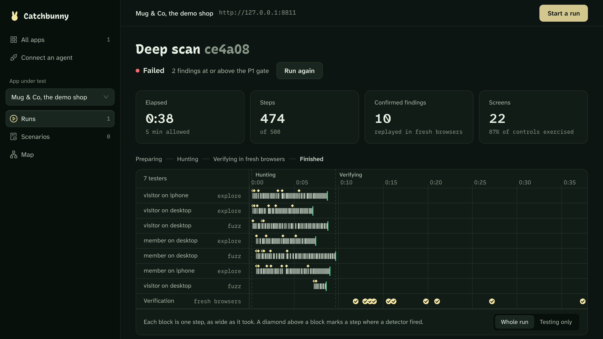
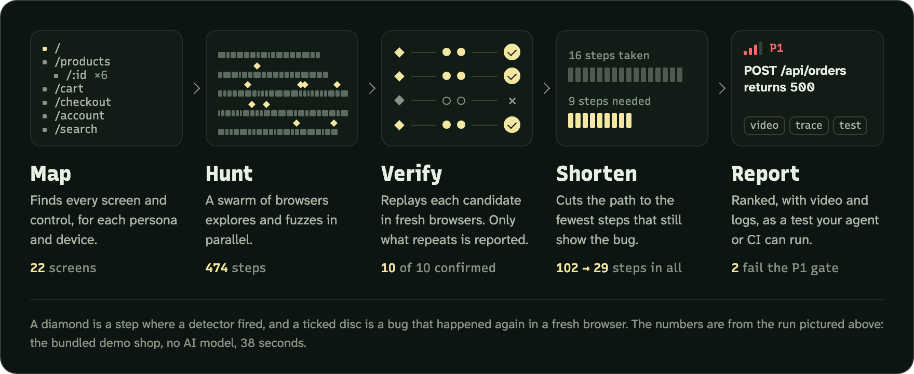
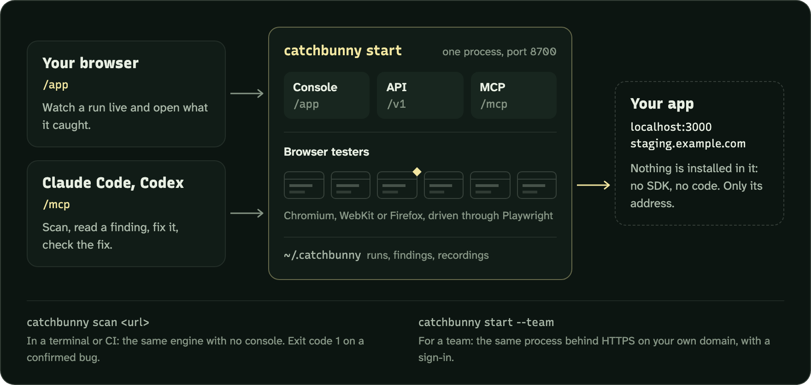
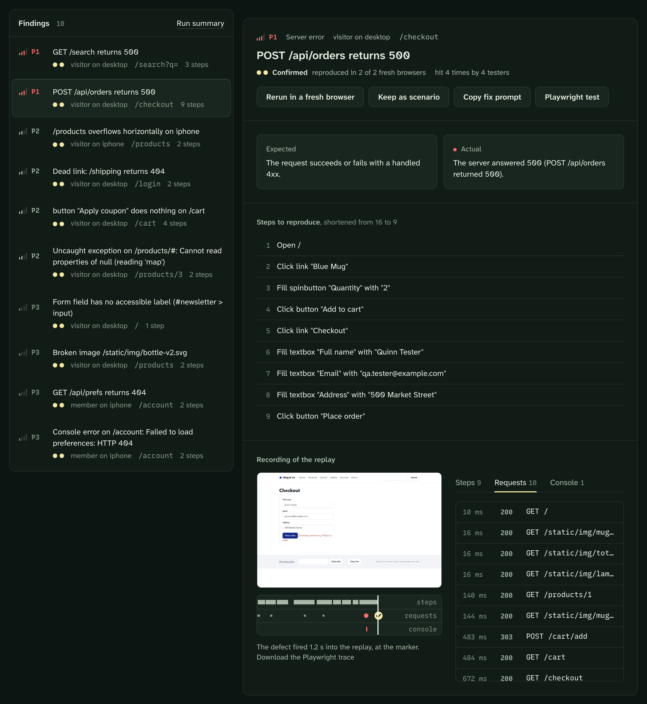

<p align="center"></p>
<h1 align="center">Catchbunny</h1>
<p align="center"><b>Browser testers that prove a bug before they report it.</b></p>
<p align="center">
  Point it at a running web app. A swarm of browsers explores it and hunts for bugs,
  replays every suspect in a fresh browser, and reports only the ones that happen again:
  each cut to the fewest steps, with a recording, and as a regression test that runs without AI.
</p>
<p align="center">
  <a href="#quick-start">Quick start</a> &nbsp;|&nbsp;
  <a href="#how-a-run-works">How a run works</a> &nbsp;|&nbsp;
  <a href="#where-it-runs">Where it runs</a> &nbsp;|&nbsp;
  <a href="#measured">Measured</a> &nbsp;|&nbsp;
  <a href="#docs">Docs</a>
</p>



<p align="center"><sub>A real run. Catchbunny scanned the bundled demo shop in 38 seconds and confirmed 10 bugs, with no AI model.</sub></p>

## How a run works



Nothing is reported because it was seen once. A bug has to happen again in a browser that has never seen the app, and what reaches you is the shortest path that still shows it.

## Quick start

Tested on macOS. Linux should work the same way; Windows has not been tried.

```bash
curl -LsSf https://raw.githubusercontent.com/cpldxx/catchbunny/main/install.sh | sh
```

```bash
catchbunny start
```

The first line installs Catchbunny and the browser it tests with ([what the script does](install.sh)). The second, in a new terminal, opens the console at http://127.0.0.1:8700/app. Choose **Add an app** and enter the address of an app that is running, or **Scan the demo shop** to watch a run first.

There are three commands:

| Command | What it does |
|---|---|
| `catchbunny start` | Opens the console, and serves the API and the MCP endpoint, on port 8700 |
| `catchbunny scan <url>` | Scans from a terminal or CI. Exit code 0 passed, 1 a confirmed bug at the gate or above, 2 could not test |
| `catchbunny connect` | Points Claude Code and Codex at the MCP endpoint |

## Where it runs



- **Nothing goes into your app.** No SDK and no code. Catchbunny opens it the way a person would, so it needs only the address.
- **One process, one port.** The console and your coding agent talk to the same server, so a scan the agent starts shows in the console as it happens.
- **Your agent can close the loop.** After `catchbunny connect`, ask Claude Code or Codex: *scan http://localhost:3000 with Catchbunny and fix what it finds.* It scans, reads a finding, fixes it, and checks the fix. [More](docs/coding-agents.md)
- **Testers need no AI.** They explore and fuzz by rule. Add Claude, or a local model through Ollama, for bugs that raise no error. [More](docs/models.md)

## What you get for each bug

<p align="center"></p>

What was expected and what happened, the steps to reproduce, and the recording of the replay that confirmed it, with every request and console line on the same clock. One click reruns it in a fresh browser, keeps it as a regression scenario, exports a Playwright test, or copies a fix prompt for your coding agent.

## Measured

On the bundled benchmark, a shop with planted bugs and traps that look like bugs, with no AI model:

| Result | What was measured |
|---|---|
| **9 of 9** | planted bugs that raise an error, found |
| **10 of 10** | confirmed findings are real, and none are reported on the fixed build |
| **78 → 28** | steps to reproduce, after shortening |
| **10 of 10** | exported regression tests fail on the buggy build and pass on the fixed one, with no model calls |
| **4.6×** | faster with 8 testers than with 1 |

Two more planted bugs raise no error, so only a tester that understands the page can see them. With Claude Opus 5.5 driving the testers, one run confirmed both, for $0.75. Full numbers: [bench/RESULTS.md](bench/RESULTS.md).

## Docs

| Page | What is in it |
|---|---|
| [How it works](docs/how-it-works.md) | Architecture, the concurrency model, design decisions, the evidence kept for a finding |
| [Coding agents](docs/coding-agents.md) | The MCP endpoint and its tools, for Claude Code, Codex, Claude and ChatGPT |
| [Teams](docs/teams.md) | Serve it on your own domain with a sign-in, keys and connectors |
| [Models](docs/models.md) | Claude and local models: what each found, and what it cost |
| [Console and design](docs/console.md) | The web console, the landing page, the design system |
| [HTTP API](docs/api.md) | Every route and event |
| [Limits](docs/limits.md) | What it does not do yet |
| [Development](docs/development.md) | A checkout, the tests, the layout |

`catchbunny start` also serves the product's own documentation at `/docs`, beside the landing page at `/`.

Built with Python, asyncio, Playwright, FastAPI, SQLite and MCP. The console is React, TypeScript, Ant Design and Vite.
