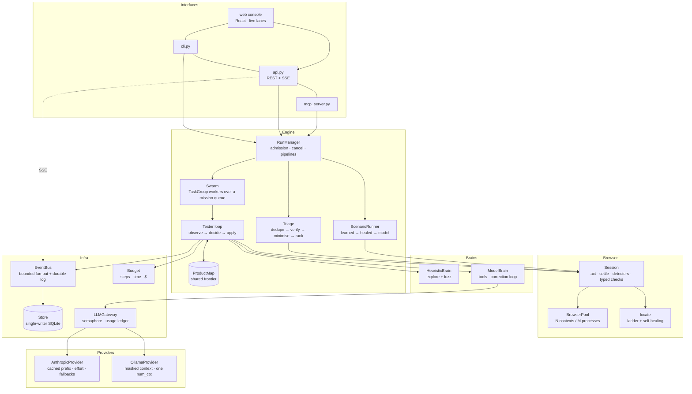

# How Catchbunny works

The engine behind a run: the layers, what a run does stage by stage, how the swarm is kept concurrent and correct, and the decisions behind it. The [README](../README.md) has the short version.

## Architecture

| Layer | Module | Responsibility |
|---|---|---|
| Domain | `domain.py` | Vocabulary shared by every layer: `Action`, `ElementSig`, `Check`, `Signal`, `Finding`, `Scenario`, `Run`. No I/O. |
| Browser | `browser/observe.py` | One `evaluate` call turns the DOM into an `Observation`: controls with durable signatures, page-level defects, state identities. |
| | `browser/locate.py` | Finds a recorded element in a different page load: exact locators first, similarity-based healing last, refusal when ambiguous. |
| | `browser/session.py` | Browser pool; per-tester session with always-on detectors, adaptive settling, typed checks, policy guard. |
| Brains | `brain/base.py` | The `Brain` port: `decide(observation, feedback) → intents`. |
| | `brain/heuristic.py` | No model: systematic exploration and form fuzzing (valid / empty / hostile / boundary input). |
| | `brain/llm.py` | Everything about a model-driven tester that is not specific to one model API: the tool vocabulary, the prompts, the tester loop, planner, outcome judge, the gateway, and the `Provider` port. |
| | `brain/claude.py` | Anthropic provider: frozen cached prefix, effort, refusal fallbacks, pricing. |
| | `brain/ollama.py` | Ollama provider: native `/api/chat`, a masked view of the transcript, one context size for every request. |
| Engine | `engine/productmap.py` | The swarm's blackboard: screens, transitions, and `claim()` - the one coordination primitive. |
| | `engine/tester.py` | One mission in one browser: the loop every brain runs through. |
| | `engine/replay.py` | Deterministic replay and parallel delta debugging. |
| | `engine/triage.py` | Signals → findings: dedupe, fresh-browser verification, localise, minimise, rank. |
| | `engine/scenarios.py` | Scenario files, learned-step replay, and exports (scenario YAML, Playwright test, fix prompt). |
| | `engine/orchestrator.py` | `App` (composition root) and `RunManager` (discovery, deep scan, scenario pipelines). |
| Infra | `store.py`, `events.py`, `budget.py`, `vault.py` | Persistence, event stream, shared budget, encryption of stored passwords. |
| Interfaces | `api.py`, `cli.py`, `mcp_server.py` | Thin: validate, delegate, serialise. REST + SSE for a UI, a CLI for CI, MCP tools for coding agents. |

### What a run does

1. **Prepare** - load the project's map from earlier runs; sign in once per persona (single-flight) and copy that session into every tester.
2. **Plan** - explorers for every persona × device, fuzzers for every persona; with a model, a mapping phase feeds a planner that writes goal-directed charters.
3. **Swarm** - `testers` workers pull missions from a queue. Each runs `observe → decide → apply`; `ProductMap.claim()` gives every unexplored control to exactly one tester.
4. **Triage** - one candidate per defect signature, represented by its least-privileged witness; replay it in fresh contexts (`confirmed` / `flaky` / `not reproduced`); try the actions since the last page load first, then delta-debug down to a minimal reproduction; replay that once more on camera.
5. **Report** - findings ranked by evidence-based severity. A confirmed finding at or above the gate (`P1` by default) fails the run and the process exit code. A run that could not test what it was asked to (app down, a persona that cannot sign in) is `blocked`, never `passed`.

### Concurrency model

Everything a tester waits on is I/O (CDP round trips, model calls), so the whole swarm is one asyncio event loop. Threads appear only where the work is blocking: SQLite and file writes go through `asyncio.to_thread`.

| Mechanism | Where | Why |
|---|---|---|
| Contexts, not browsers | `BrowserPool` | A context is isolated (cookies, storage) and costs milliseconds; a browser process per tester would not. Contexts per process are capped, total contexts are bounded by a semaphore. |
| Lock-free shared state | `ProductMap.claim`, `Budget.take_step` | Synchronous methods cannot interleave on one loop, so check-and-reserve is atomic without locks: two testers never take the same control or the last step. |
| Structured concurrency | `RunManager._swarm` | Workers live in a `TaskGroup`; a mission catches its own failure, cancellation propagates through the group and releases every context. |
| Single-flight sign-in | `_signed_in_state` | N explorers of one persona trigger one login and share its session. |
| Account lock + fresh sign-in | `RunManager.session(exclusive=True)` | Work whose verdict depends on state (verification, minimisation, scenarios) gets its own sign-in and holds the persona's account, so replays neither inherit leftovers from the hunt nor rearrange one account under each other. Anonymous personas stay fully parallel. |
| Settling by asking the page | `Session.settle` | No fixed sleeps. A step ends when the page itself reports nothing in flight (fetch/XHR counted at the call site, pending navigation, images) and no DOM mutation for 40 ms, *and* the browser reports no request in flight. |
| Single-writer store | `Store` | All writes go through one queue and are group-committed in one thread hop; hot-path writes never block a tester; WAL keeps reads concurrent. |
| Bounded fan-out | `EventBus` | `publish` is synchronous; each subscriber has a bounded queue that drops its oldest event, so a stalled SSE client cannot slow the swarm. History + live resume has no gap and no duplicate. |
| Parallel delta debugging | `replay.ddmin` | All chunks and complements of a round are replayed concurrently, each in its own context. |

### Design decisions

- **Evidence over opinion.** Verdicts rest on typed checks and detector signals. A model's bug report is rejected unless it supplies a check that fails on the live page, and it is confirmed only if that check fails again on replay.
- **Verify before reporting.** Nothing is shown as a bug because it was seen once. Fresh-browser replay is what keeps precision at 100% on the benchmark.
- **Absence is a claim, not a proof.** A check that fails because the wrong thing *is* on the page (`text_absent`, a field holding the wrong value) is an observation a replay can repeat. A check that fails because something is *missing* looks the same whether the app is broken or the expectation was wrong - and deleting steps can only keep it missing, so minimisation would shrink such a "proof" to a bare page load. Those reports are kept but labelled unverified, and a check on a control that does not exist is rejected outright. For the same reason a model's report is never minimised: its check is evidence, not a complete oracle. These rules exist because local models produced exactly these failures: see [Model providers](models.md).
- **Ports for the expensive parts.** The engine does not know whether a model, rules or a test script is driving. The model side has a second port, `Provider`, so the tester loop does not know which model API it is talking to either. That is what makes the system testable end to end with no network, and runnable with no API key.
- **Conservative healing.** A moved control is re-found by similarity only when the best match is good *and* clearly better than the runner-up. A wrong click is worse than a failed step.
- **A reproduction must stand on its own.** It starts from a named page, is replayed from a clean sign-in, and prefers the least-privileged persona that can hit the bug - so it never depends on a cart someone else filled or on where a session happened to be standing.
- **Verdicts must not depend on timing.** "This button does nothing" is decided from the page's own counters (DOM hash, calls it started, side effects), not from which network events happened to arrive in a time window.
- **A persona on a device is its own app.** Exploration progress is scoped per persona × device, and site chrome (nav, header, footer) is explored once per scope rather than once per screen.
- **Supervisor-enforced policy and secrets.** `read_only` / `safe_writes` / `full` is checked before every action, for every brain. Passwords are injected at execution time and never enter a trace, an event or a prompt.

### What profiling changed

One tester spent 73% of every step waiting for the page to "settle" (160 ms of a 220 ms step), because settling meant "no network activity for 120 ms". Replacing that with the page-side quiescence check above cut it to 65 ms: **5.0 → 9.1 steps/s per tester, 34 → 53 steps/s at 8 testers**, with the same findings.

The shorter window also exposed three latent nondeterminisms, each now covered by a regression test:

1. The dead-click verdict counted browser network events, so a late favicon request could flip it → it now reads the page's own call counter.
2. Self-healing matched on role, tag and position, and once healed "Apply coupon" onto "Copy link" on an empty cart → a named control is never healed onto a differently named one.
3. Testers of one signed-in persona shared a server session, so minimisation could "shrink" a reproduction into relying on items another tester had left in the cart → account lock, fresh sign-in, and least-privileged witness.

## Evidence

Every confirmed finding is replayed one final time with recording on (`RunSpec.record`, default true):

| | |
|---|---|
| `video` | WebM of the reproduction |
| `trace` | Playwright trace archive (DOM snapshots per action; open with `playwright show-trace`) |
| `timeline` | each action with its start time and duration |
| `network`, `console` | every request (method, URL, status, type) and console message, on the same clock |
| `fired_at_ms` | when the defect showed itself, for "jump to the moment" playback |

## How it relates to existing products

The feature set was reconstructed from the public documentation and marketing pages of four products in this space (Composal, Simulithic, Canary, Aucert). No account was created and no private interface was inspected.

| Observed in the reference products | Here |
|---|---|
| Discovery maps screens and flows and suggests tests | `discovery` run: shared product map, scenario drafts written from observed journeys and kept only if they replay |
| Parallel testers pressure-test flows toward a goal | `deep_scan` run: explorers + fuzzers, plus model charters (Claude or a local model) planned from the map |
| Findings carry expected / actual / steps / recording / logs, with "rerun in a fresh browser" as a button | Every finding is re-run automatically before it is reported, then recorded (video, trace, network, console); `POST /findings/{id}/rerun` on demand |
| "Keep it as a scenario", "send to your coding agent" (CLI + MCP) | `export --format scenario \| playwright \| prompt`, and an MCP server (stdio and HTTP) with `scan` / `get_finding` / `verify_fix` / `run_scenarios`, registered with `catchbunny connect` |
| Shared-account locks | Per-persona account lock around every state-asserting session |
| Scenarios in plain English with expected outcomes | Same, plus typed checks that the engine evaluates itself |
| Learned steps: replay a passing run's actions, heal moved controls, fall back to the model | `ScenarioRunner` ladder: learned → healed → model, 14-day TTL, checks re-evaluated on the live page |
| Allowed actions, test accounts the model cannot read | Policy guard and supervisor-injected credentials |
| Pick the scenarios a pull request affects | `POST /projects/{id}/relevance` (lexical baseline) |
| Device matrix | Device profiles per mission; exploration scoped per device |
| Release gate | Run status + exit code from confirmed findings at or above `gate` |

Where this goes further: verification is automatic rather than a button; reproductions are minimised by delta debugging; a regression scenario exported from a finding runs with zero model calls; and the whole pipeline has a reproducible seeded-bug benchmark with a false-positive check.
